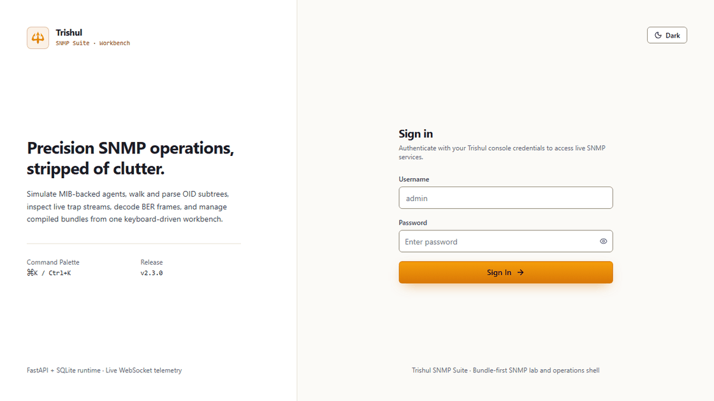

# 🔱 Trishul SNMP Suite

[](https://github.com/tosumitdhaka/trishul-snmp-suite/stargazers)
[](https://github.com/tosumitdhaka/trishul-snmp-suite/network)
[](https://github.com/tosumitdhaka/trishul-snmp-suite/issues)
[](LICENSE)
[](https://github.com/tosumitdhaka?tab=packages&repo_name=trishul-snmp-suite)

Trishul SNMP Suite is a bundle-first SNMP lab and operations shell. The
`2.3.0` release introduces a complete **UI Overhaul & Frontend Migration** — replacing the legacy vanilla HTML/JS pages in `frontend/` with a React 19, TypeScript, and Tailwind CSS v4 workbench aligned to the `@trishul-developers/tokens` light/dark design system, while keeping the FastAPI + SQLite + pure-Python `trishul-smi` / `trishul-snmp` runtime unchanged.



## 2.3.0 Highlights

- **Modern React 19 + TypeScript UI Migration (`frontend/`)**: replaced the legacy vanilla HTML/JS UI and removed the split `frontend-next/` staging tree, making the modern 7-workspace workbench (`Overview`, `Simulator`, `Walk & Parse`, `Traps`, `MIB Browser`, `MIB Manager`, `Settings`) the single default operator interface built into `frontend/dist`.
- **Trishul Design System & WCAG Contrast**: warm paper (`#fbfaf7`) light theme and ink-navy (`#0b0d12`) dark theme with Trident amber gradient primary CTAs, accessible form control outlines, keyboard focus rings, Radix UI focus-trapped dialogs/drawers, and an expandable sidebar with topbar theme switch, `⌘K` / `Ctrl+K` Command Palette, and account menu.
- **Full Backend Contract & Classic Feature Parity**:
  - **Overview**: live runtime status pills, start/stop toggles, 8-counter activity telemetry, recent live stream, and workspace shortcuts.
  - **Simulator**: UDP responder lifecycle on port `1061`, JSON custom OID override editor with MIB OID insertion drawer, startup custom-data warnings banner, restart-required indicator, and live traffic log stream with `.txt`/`.json` export.
  - **Walk & Parse**: live Root OID / Symbol typeahead suggestions, flat/grouped/raw result tables, column sorting, inline search filter across table/JSON/raw modes, CSV/JSON/TSV export, walk cancellation, and persistent walk history.
  - **Traps**: live catalog template filter with instant match list, varbind builder with MIB object picker and smart validation/defaults, Trap/Inform sending with ACK error verification, server-paginated receiver table with 4-metric strip, detail drawer with expandable raw trap JSON, replay overrides, and offline BER payload decoder.
  - **MIB Browser & MIB Manager**: dual By-Module / By-OID trees with depth `1..5` expansion, formatted SMI constraint badges (`range`, `size`, `enums`, `bits`), drag-and-drop MIB upload strip, batch validation with shadowing checks, content-hash bundle diffing, and one-click rollback.
  - **Settings**: credential rotation (`readOnly` username, password strength meter), persisted app defaults, stats reset/export, and `@mib@` remote source validation.
- **Retained 2.2.x Platform Foundations**: single FastAPI application in `backend/app`, SQLite state + bundle lifecycle management, `/api/ws` real-time push with reconnect watchdog, masked community inputs, and pure-Python `trishul-smi` + `trishul-snmp` execution.

## Quick Start

Try the published release in one command:

```bash
curl -LfsS -o install-trishul-snmp-suite.sh \
  https://raw.githubusercontent.com/tosumitdhaka/trishul-snmp-suite/main/install-trishul-snmp-suite.sh \
  && bash install-trishul-snmp-suite.sh up
```

If you want to pin the installer to a specific release, replace `main` in the
URL with a release tag such as `v2.3.0`.

From a local checkout, start the published image with:

```bash
./install-trishul-snmp-suite.sh up
```

Build and run the current checkout with:

```bash
./install-trishul-snmp-suite.sh up-local
```

Default access:

- app UI: `http://localhost:8980`
- API docs: `http://localhost:8980/docs`
- default login: `admin` / `admin123`

Optional compatibility access can be added with `BACKEND_PORT=<port>` if you want the same app exposed on a second host port.

If you redeploy without `APP_PORT` or `BACKEND_PORT` overrides, the installer
reuses the current host mapping. Set `BACKEND_PORT=none` on the next restart if
you want to remove the compatibility alias.

Change the default credentials immediately in `Settings`.

### Image And Platform Overrides

The current installer accepts:

- `--platform linux/amd64|linux/arm64`
- `--image <ref>`
- `TRISHUL_IMAGE`
- `DOCKER_PLATFORM`
- `TRISHUL_DOCKER_PLATFORM`

Examples:

```bash
./install-trishul-snmp-suite.sh up --platform linux/arm64
./install-trishul-snmp-suite.sh up --image ghcr.io/tosumitdhaka/trishul-snmp-suite:latest
./install-trishul-snmp-suite.sh up-local --image trishul-snmp-suite-local:test --platform linux/amd64
```

### Legacy 1.4.1 Runtime

If you need the pinned merged runtime from the old line:

This section is intentional compatibility guidance for coexistence or rollback,
not the normal `2.3.0` runtime path.

```bash
./install-trishul-snmp-suite-v1.4.1.sh up
```

That path keeps:

- container name `trishul-snmp`
- volume name `trishul-snmp-data`
- parallel-safe defaults `8081`, `2161/udp`, and `2162/udp`

It also accepts the same `--platform` and `--image` overrides.

## UI Map

- `Overview`: runtime status pills, start/stop controls, 8-counter activity telemetry, recent live stream, and quick links
- `Simulator`: responder lifecycle (`1061/udp`), custom OID JSON editor, OID picker, and filterable activity log
- `Walk & Parse`: SNMP walk execution, Root OID/Symbol typeahead, flat/grouped/raw tables, filtering, and JSON/CSV/TSV export
- `Traps`: listener control (`1162/udp`), live-filtered trap catalog templates, varbind composer, inform ACK, paginated stream, expandable trap JSON inspector, replay, and BER decoder
- `MIB Browser`: module or OID tree with depth `1..5` expansion, search, resolve, formatted constraint badges, and detail inspection
- `MIB Manager`: drag-and-drop MIB upload with inline Upload CTA, compile validation, dependency fetch, trap catalog, bundle diffing, and rollback
- `Settings`: credential rotation, app settings, stats reset or JSON export, and product metadata

## Runtime Model

The current `2.3.0` path is built around:

- `backend/app` as the live FastAPI runtime
- `frontend/` (React 19, Vite, TypeScript, Tailwind CSS v4) built into `frontend/dist`
- `backend/data/trishul_v2.sqlite3` as the main durable data store
- `backend/data/bundles/sets/` and `backend/data/bundles/cache/tsmi/` for bundle artifacts
- `backend/data/mibs/` and `backend/data/configs/custom_data.json` for operator-shell runtime state
- `/api/ws` for live shell events such as status, stats, traps, and simulator log updates

There is no Nginx layer in the current release path. Real-time updates come
directly from FastAPI over `/api/ws`; the old split-runtime WebSocket bridge is
gone.

## Documentation

Start with:

- [Docs Home](docs/index.md)
- [Installation Guide](docs/installation_guide.md)
- [First Steps](docs/first_steps.md)
- [Workspaces](docs/workspaces.md)
- [Architecture Overview](docs/architecture_overview.md)
- [API Reference](docs/api_reference.md)

Operator guides:

- [MIB Manager Guide](docs/mib_manager_guide.md)
- [MIB Browser Guide](docs/mib_browser_guide.md)
- [Simulator Guide](docs/snmp_simulator_guide.md)
- [Walk & Parse Guide](docs/walker_guide.md)
- [Traps Guide](docs/trap_manager_guide.md)

Development and release:

- [Development Setup](docs/development_setup.md)
- [Release Process](docs/release_process.md)
- [Roadmap](docs/roadmap.md)
- [Issue Tracker](docs/issue_tracker.md)
- [GitHub Workflow](docs/github_workflow.md)

## Development

Typical verification commands from the repo root:

```bash
npm --prefix frontend run typecheck
npm --prefix frontend run lint
npm --prefix frontend test
npm --prefix frontend run build
.venv/bin/python -m pytest backend/ -q
.venv/bin/python scripts/check_backend_coverage.py
docker build -t trishul-snmp-suite-local:rc .
```

For Docker-backed local validation:

```bash
./install-trishul-snmp-suite.sh up-local
./install-trishul-snmp-suite.sh logs
./install-trishul-snmp-suite.sh status
```

## Roadmap

The `2.3.0` release completes the React 19 / TypeScript UI overhaul and
replaces the legacy vanilla HTML/JS shell in `frontend/` on top of the FastAPI
+ SQLite + `trishul-smi`/`trishul-snmp` platform.

The next planned follow-up keeps the current operator shell and adds schema
depth and protocol reach: display hints, SMIv1 generic-trap decoding, a
compile-time lint gate, v1 walker support, and SNMPv3 exposure, plus saved
profiles and system diagnostics.

Deferred beyond `2.0.x`:

- SNMPv3 runtime and UI parity
- writable `SET` responder behavior
- bundle import and export workflows
- one-click ecosystem demo flows
- distributed polling or orchestration features

See [docs/roadmap.md](docs/roadmap.md), [docs/issue_tracker.md](docs/issue_tracker.md), and [docs/changelog.md](docs/changelog.md) for the maintained release record.

## Contributing

Contributions are welcome.

Useful starting points:

- [docs/development_setup.md](docs/development_setup.md)
- [docs/github_workflow.md](docs/github_workflow.md)
- [docs/issue_tracker.md](docs/issue_tracker.md)
- [.github/CONTRIBUTING.md](.github/CONTRIBUTING.md)

## License

MIT. See [LICENSE](LICENSE).
